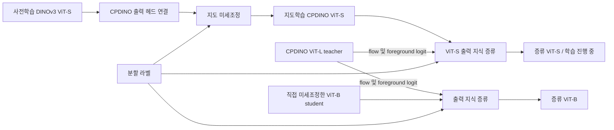

# CPDINO Compression Lab

## 출력 지식 증류와 ViT-S 백본 이식을 통한 세포 인스턴스 분할 모델 경량화

### 초록

본 연구는 CPDINO 기반 세포 인스턴스 분할에서 Vision Transformer의 규모와 학습 방법에 따른 정확도 및 추론 비용을 비교한다. CPDINO ViT-L을 teacher로 사용하여 기존 ViT-B student에 출력 수준 지식 증류를 적용한다. 별도의 경량화 실험에서는 공식 DINOv3 ViT-S 사전학습 인코더를 CPDINO에 연결하고, 새로 초기화한 출력 헤드와 함께 지도 미세조정한다. 각 모델은 동일한 flow 및 foreground logit 출력 형식을 사용한다. 64장의 test 이미지에서 증류 ViT-B의 AP@0.5와 AP@0.75는 각각 0.8212와 0.7396으로 측정되었다. 500-epoch 지도학습을 완료한 ViT-S의 AP@0.5와 AP@0.75는 각각 0.6745와 0.5272이며, 평균 이미지 지연시간은 679.7 ms이다. 해당 체크포인트에서 CPDINO ViT-L을 teacher로 사용하는 500-epoch 추가 증류를 수행 중이다. 저장소는 모델 구성, 손실 함수, 학습 연산 및 체크포인트 복원을 PyTorch 모듈과 실행 가능한 노트북으로 제공한다.

### 1. 연구 범위

ViT-B 실험은 기존 분할 모델에 대한 추가 지식 증류이며, ViT-S 실험은 소형 백본 이식 후 지도 미세조정이다. ViT-B student는 직접 미세조정한 CPDINO 체크포인트에서 초기화한다. ViT-S는 일반 시각 표현을 학습한 DINOv3 인코더에서 초기화하며, CPDINO 출력 헤드는 무작위 초기화한다. ViT-S 지도학습에는 teacher를 사용하지 않는다. 추가 증류는 지도학습을 완료한 ViT-S 전체 가중치에서 초기화하며, CPDINO ViT-L의 출력을 학습 대상으로 사용한다.



### 2. 모델 구성

| 구성 요소 | ViT-L | ViT-B | ViT-S |
|---|---:|---:|---:|
| Transformer blocks | 24 | 12 | 12 |
| Embedding dimension | 1,024 | 768 | 384 |
| Attention heads | 16 | 12 | 6 |
| Head dimension | 64 | 64 | 64 |
| MLP hidden dimension | 4,096 | 3,072 | 1,536 |
| 백본 파라미터 수 | 303,154,176 | 85,669,632 | 21,601,152 |
| 선형 출력 헤드 | 1024 → 192 | 768 → 192 | 384 → 192 |

세 모델은 16×16 패치 커널에 stride 8과 padding 4를 적용한다. 384×384 입력에서 생성되는 2,304개 공간 토큰에 CLS 토큰 1개와 register 토큰 4개를 추가하여 Transformer에 입력한다. 최종 LayerNorm 이후 보조 토큰을 제거하고, 각 공간 토큰을 192차원으로 투영한다. 고정 가중치 `W2`는 이를 8×8×3 픽셀 출력으로 재배열한다. 출력 채널은 수직 flow, 수평 flow 및 foreground logit이며, 인스턴스 마스크는 Cellpose 후처리로 산출한다.

### 3. 학습 목적 함수

Student 예측을 $p$, teacher 예측을 $t$, flow 라벨을 $y_f$, 이진 foreground 라벨을 $y_c$로 정의한다. MSE는 해당 텐서 원소 전체의 평균제곱오차이다.

$$
\mathcal{L}_{\mathrm{task}}=\frac{1}{2}\mathrm{MSE}(p_f,5y_f)+\mathrm{BCEWithLogits}(p_c,y_c)
$$

$$
\mathcal{L}_{\mathrm{KD}}=\mathrm{MSE}(p_f,\mathrm{stopgrad}(t_f))+\mathrm{MSE}(p_c,\mathrm{stopgrad}(t_c))
$$

$$
\mathcal{L}=\mathcal{L}_{\mathrm{task}}+\lambda\mathcal{L}_{\mathrm{KD}}
$$

ViT-B 및 ViT-S 증류에는 $\lambda=1$을 적용하며 teacher의 파라미터를 고정한다. ViT-S의 선행 지도학습에는 $\lambda=0$을 적용한다. 검증 손실은 모든 실험에서 $\mathcal{L}_{\mathrm{task}}$로 계산한다. 구현은 [losses.py](src/cpdino_lab/losses.py)와 [engine.py](src/cpdino_lab/engine.py)에 수록되어 있다.

### 4. 실험 설정

| 설정 | ViT-B 증류 | ViT-S 지도 미세조정 | ViT-S 추가 증류 |
|---|---|---|---|
| 초기화 | 직접 미세조정한 ViT-B 전체 가중치 | 공식 ViT-S 인코더, 새 출력 헤드 | 지도학습 500-epoch ViT-S 전체 가중치 |
| Teacher | CPDINO ViT-L | 없음 | CPDINO ViT-L |
| Train / validation / test | 517 / 64 / 64장 | 517 / 64 / 64장 | 517 / 64 / 64장 |
| 입력 타일 | 384×384 | 384×384 | 384×384 |
| Batch size | 13 | 29 | 13 |
| Optimizer | AdamW | AdamW | AdamW |
| Learning rate / weight decay | 1e-5 / 0.1 | 1e-5 / 0.1 | 1e-5 / 0.1 |
| 학습 길이 | 500 epochs 완료 | 500 epochs 완료 | 추가 500 epochs 진행 중 |
| 검증 주기 | 첫 epoch 및 이후 10 epochs마다 | 첫 epoch 및 이후 10 epochs마다 | 첫 epoch 및 이후 10 epochs마다 |
| Seed | 20261112 | 20261112 | 20261112 |

패치 투영은 원본 CPDINO forward의 gradient 차단 동작에 따라 고정한다. Transformer와 선형 출력 헤드는 최적화 대상이며, 픽셀 재배열용 `W2`는 고정한다. 설정 파일은 [ViT-B 증류](configs/vitb-distillation.json), [ViT-S 지도 미세조정](configs/vits-supervised.json), [ViT-S 추가 증류](configs/vits-distillation.json)로 구분한다.

### 5. 평가 결과

다음은 2026년 11월 13일 ViT-S 평가 완료 후 수록한 기존 학습 실험의 집계값이다. 평가 장치는 NVIDIA GeForce RTX 5090이며, 추론 정밀도는 PyTorch BF16이다.

| 모델 | Cellpose AP@0.5 | AP@0.75 | 세포 수 MAE | 평균 이미지 지연시간 (ms) |
|---|---:|---:|---:|---:|
| CPDINO ViT-L | 0.8246 | 0.7443 | 27.5469 | 1,265.5 |
| 직접 미세조정 ViT-B | 0.8201 | 0.7322 | 25.2656 | 843.7 |
| 증류 ViT-B | 0.8212 | 0.7396 | 26.6719 | 806.4 |
| 지도 미세조정 ViT-S | 0.6745 | 0.5272 | 91.0781 | 679.7 |
| 증류 ViT-S | 평가 대기 | 평가 대기 | 평가 대기 | 평가 대기 |

AP는 IoU 임계값에서의 Cellpose instance matching 점수 `TP / (TP + FP + FN)`를 이미지별로 계산한 뒤 평균한 값이다. 지연시간은 이미지당 3회 측정의 중앙값을 구한 뒤 64장에 대해 평균하였으며, 디스크 읽기와 모델 로딩은 제외하였다. 평가의 세부 설정과 원본 결과 파일 해시는 [historical-summary.json](results/historical-summary.json)에 기록되어 있다.

증류 ViT-B의 AP@0.75는 직접 미세조정 ViT-B보다 0.0074 높았으나, 세포 수 MAE는 증가하였다. 두 ViT-B 모델의 아키텍처는 동일하다. GPU 동시 작업 통제와 반복 실험의 분산이 기록되지 않았으므로 관측된 지연시간 차이를 증류의 효과로 단정할 수 없다. 일부 평가 라벨에는 모델 기반 생성 이력이 있다. 지도학습 ViT-S는 더 낮은 지연시간과 함께 AP 감소 및 세포 수 MAE 증가가 관측되었다. ViT-B와 ViT-S는 초기 가중치 및 출력 헤드의 학습 이력이 다르므로, 두 모델의 비교에는 아키텍처 외의 요인이 포함된다. ViT-S 추가 증류의 최종 성능은 학습과 동일 test split 평가가 완료된 뒤 별도로 보고한다.

### 6. 구현과 실행

Python 3.11과 PyTorch 2.8을 사용하며, Cellpose 4.2.1.1과 DINOv3의 특정 커밋을 의존성으로 지정한다. Jupyter 또는 VS Code에서 저장소를 연 뒤 설치 셀을 실행한다.

```python
%pip install -e ".[dev]"
```

| 노트북 | 실행 범위 | 입력 |
|---|---|---|
| [01 — 구성 요소 검증](notebooks/01_units.ipynb) | Forward, 손실, optimizer step, 체크포인트 복원, 단위 테스트 | CPU 합성 텐서 |
| [02 — 학습 및 검증](notebooks/02_training.ipynb) | 설정, 데이터 로딩, 가중치 초기화, 한 batch, 한 epoch, 검증 및 재개 | 로컬 데이터와 가중치 |
| [03 — 평가 결과](notebooks/03_results.ipynb) | 기존 실험 집계값 로딩 및 비교 | 공개 결과 JSON |

데이터 디렉터리는 `train` 또는 `train_eligible`, `valid`, `test`로 구성한다. 원본 실험의 학습 분할은 `training_split="train_eligible"`로 명시한다. 학습·검증 이미지는 `.jpg`이며, 대응 라벨은 같은 stem의 `_flows.tif`이다. Flow TIFF의 채널 순서는 `[instance IDs, foreground, flow_y, flow_x]`이고, 배치 구성 시 instance ID 채널을 제거한다. 데이터와 가중치 경로 및 SHA-256은 [local-paths.example.json](configs/local-paths.example.json)을 기준으로 저장소 루트의 `local_paths.json`에 지정한다. 데이터와 가중치는 저장소에 포함하지 않는다.

공개 구현은 원본 모델 forward와 손실 계산에 기반하며, ViT-S 추가 증류는 이 저장소의 학습 단위로 실행한다. `prepare_models`는 인코더 초기화와 전체 분할 모델 초기화를 구분하고, `train_epoch`는 한 epoch의 학습과 지도 손실 검증을 수행한다. `EpochStore`는 최저 검증 손실의 `best.pt`와 재개용 `last.pt`를 저장한다. 재개 시 모델, optimizer, 난수 상태와 최적 epoch를 복원한다. 노트북의 기본 실행 디렉터리는 자동 실행 작업과 분리한다.

기존 ViT-B 및 ViT-S 지도학습 수치는 원본 실험 산출물에서 수집하였으며, 추가 증류의 상태는 [vits-distillation.json](results/vits-distillation.json)에 기록한다. 검증 범위는 [verification.md](docs/verification.md)에 명시한다.

### 7. 문서 및 기반 구현

연구 배경, 방법과 결과 해석은 [연구 보고서](docs/study.ko.md)에, 텐서 규격과 모듈별 동작은 [구현 명세](docs/method.md)에 기술한다. [아키텍처 비교 HTML](docs/architecture.html)은 다운로드 후 브라우저에서 실행할 수 있다.

기반 구현은 [Cellpose CPDINO](https://github.com/MouseLand/cellpose/blob/main/cellpose/vit.py)와 [Meta DINOv3](https://github.com/facebookresearch/dinov3)이다. 본 저장소는 이들 구현을 이용한 출력 증류, ViT-S 백본 연결 및 실험 실행 코드를 제공한다. 라이선스와 출처는 [THIRD_PARTY_NOTICES.md](THIRD_PARTY_NOTICES.md)에 기재한다.
