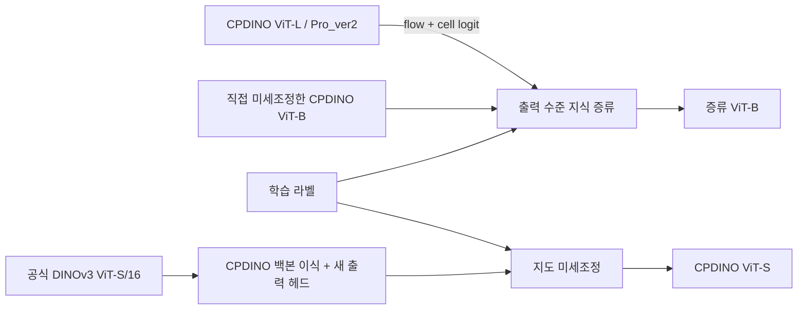

# CPDINO Compression Lab

**지식 증류와 소형 ViT 백본 이식을 통한 세포 인스턴스 분할 모델 경량화**

CPDINO ViT-L을 교사로 사용해 ViT-B의 출력을 증류하고, 공식 DINOv3 ViT-S 백본에 Cellpose 출력 헤드를 연결해 라벨 지도학습을 수행한 프로젝트입니다. 구현을 Python 모듈, 단위 테스트와 Jupyter 노트북으로 정리했습니다.

**Knowledge distillation and lightweight backbone adaptation for cell instance segmentation.**

## 두 가지 실험



- **Output-level knowledge distillation** — 직접 학습한 ViT-B를 초기 학생으로 사용하고, 라벨 손실에 ViT-L의 두 flow 채널과 세포 logit을 따라가는 MSE를 추가했습니다.
- **Backbone substitution and supervised fine-tuning** — DINOv3 ViT-S/16의 사전학습 인코더를 CPDINO에 연결하고, 새 `Linear(384, 192)` 헤드와 Transformer를 학습했습니다. 이 실험의 teacher weight는 0입니다.

Meta의 공식 DINOv3 S/B/L 가중치는 upstream 사전학습 단계에서 distilled 모델로 제공됩니다. 여기서 출력 증류는 사용자 데이터에 대한 별도 학습 단계입니다.

## 구조 비교

| 항목 | ViT-L | ViT-B | ViT-S |
|---|---:|---:|---:|
| Transformer 블록 | 24 | 12 | 12 |
| 임베딩 폭 | 1,024 | 768 | 384 |
| Attention head | 16 | 12 | 6 |
| 백본 파라미터 | 303.15 M | 85.67 M | 21.60 M |
| 선형 출력 헤드 | 1024 → 192 | 768 → 192 | 384 → 192 |

공통 경로는 16×16 패치 커널, stride 8, padding 4, CLS 1개와 register 4개, 최종 LayerNorm과 선형 출력 헤드입니다. 고정 W2가 토큰별 192개 출력을 8×8×3으로 펼칩니다. Cellpose 후처리는 두 flow 채널과 세포 logit으로 개별 세포 마스크를 생성합니다.

인터랙티브 설명은 [아키텍처 비교 HTML](docs/architecture.html)을 다운로드하여 브라우저로 열 수 있습니다. [설계 및 구현 설명](docs/method.md)과 [포트폴리오 본문](docs/portfolio.ko.md)을 함께 제공합니다.

## 셀 단위로 확인하기

Python 3.11과 PyTorch 2.8을 사용합니다. 사용하는 CPU/CUDA 환경에 맞게 PyTorch를 설치한 뒤, 저장소 폴더에서 Jupyter 또는 VS Code 노트북을 엽니다. 설치 셀은 다음과 같습니다.

```python
%pip install -e ".[dev]"
```

| 노트북 | 실행 단위 | 입력 |
|---|---|---|
| [01 — 모델과 한 번의 학습](notebooks/01_units.ipynb) | 실제 DINO 블록 forward → loss → 증류 step → checkpoint 복원 → pytest | 합성 텐서, CPU |
| [02 — 실험 재현](notebooks/02_training.ipynb) | 설정 → 경로 검사 → 가중치 초기화 → 한 batch → 한 epoch → 검증 → 저장/재개 | 사용자 데이터와 가중치 |
| [03 — 결과 읽기](notebooks/03_results.ipynb) | 기록 로딩 → 정확도·속도 비교 → 제한 사항 | 저장된 집계 결과 |

첫 번째 노트북의 작은 DINO 모델은 실제 모델 코드를 빠르게 검증하는 장치입니다. 실제 ViT-S 초기화와 학습은 두 번째 노트북에 있습니다. 각 코드 셀은 출력 또는 assert로 동작을 확인합니다.

단위 테스트도 노트북에서 실행할 수 있습니다.

```python
import pytest
assert pytest.main(["tests", "-q"]) == pytest.ExitCode.OK
```

데이터는 `train` 또는 `train_eligible`, `valid`, `test` 폴더로 나눕니다. 이미지는 `.jpg`, 학습·검증 라벨은 동일 이름의 `_flows.tif`를 사용합니다. Flow TIFF의 채널은 `[instance IDs, foreground, flow_y, flow_x]`입니다. 배치 생성 시 ID 채널을 제거합니다. 테스트 마스크는 `_masks.tif`입니다.

`configs/local-paths.example.json`을 참고해 저장소 루트에 `local_paths.json`을 작성합니다. 파일 경로와 SHA-256은 사용하려는 체크포인트에 맞춰 설정합니다. 원본 이미지와 모델 파일은 각자의 로컬 환경에서 연결합니다. 공식 DINOv3 가중치 다운로드는 Meta가 안내하는 접근 절차를 따릅니다.

## 관측한 결과

2026-11-13에 기존 실험 산출물에서 읽은 집계값입니다. 재구성한 이 저장소로 전체 실험을 다시 수행한 결과는 별도 기록이 필요합니다.

| 모델 | Cellpose AP@0.5 | AP@0.75 | 이미지 지연시간 평균 |
|---|---:|---:|---:|
| Pro_ver2 · ViT-L | 0.8246 | 0.7443 | 1,265.5 ms |
| 직접 학습 ViT-B | 0.8201 | 0.7322 | 843.7 ms |
| 증류 ViT-B | 0.8212 | 0.7396 | 806.4 ms |
| ViT-S | 최종 평가 대기 | 최종 평가 대기 | 최종 평가 대기 |

평가는 독립 test split 64장, PyTorch BF16 기준입니다. AP는 Cellpose의 instance matching 점수이며 이미지별 `TP / (TP + FP + FN)`을 평균합니다. 이미지당 3회 측정의 중앙값을 구한 뒤 평균한 지연시간이며 파일 읽기와 모델 로딩을 제외합니다. 일부 라벨은 AI 기반 생성 이력이 있고, GPU 동시 작업과 반복 실험 분산은 통제 여부가 기록되지 않았습니다. 증류 B와 직접 학습 B의 작은 점수 차이는 이 평가셋의 관측값입니다.

[집계 JSON](results/historical-summary.json)에 원본 결과 파일 SHA-256, 평가 설정과 확인 시점을 보존했습니다. 이미지 ID, 사용자 절대 경로와 학습 이미지는 이 집계에 포함하지 않습니다.

## 코드 단위

- `models.py` — 인코더 주입, upstream CPDINO forward 재사용, S/B/L 생성
- `weights.py` — SHA-256 검증, 공식 Hugging Face 텐서 변환, raw/wrapped checkpoint 로딩
- `losses.py` — Cellpose 지도 손실과 출력 증류 손실
- `data.py` — split 중복 검사, 파일 쌍 연결, Cellpose 배치 증강
- `engine.py` — 한 번의 optimizer step와 sample-weighted 검증
- `checkpoints.py` — 모델·optimizer·RNG의 원자적 저장과 복원

현재 코드는 원본 실행 스크립트를 모듈로 재구성했습니다. 원본은 백본 생성 함수를 임시 교체했고, 여기서는 인코더를 명시적으로 주입합니다. 패치 투영은 upstream `.data` 사용으로 고정되는 동작을 `requires_grad=False`로 명시했습니다. 원본 학습 실행 파일과 초기 가중치 해시는 결과 기록에 남겼습니다.

## 기반 프로젝트

[Cellpose](https://github.com/MouseLand/cellpose)의 CPDINO 구현과 [DINOv3](https://github.com/facebookresearch/dinov3)의 백본 및 가중치를 사용합니다. 이 저장소의 기여는 백본 연결, 출력 증류 실험, 재현 단위 구성과 검증입니다. 사용 조건과 출처는 [THIRD_PARTY_NOTICES](THIRD_PARTY_NOTICES.md)에 정리했습니다.
