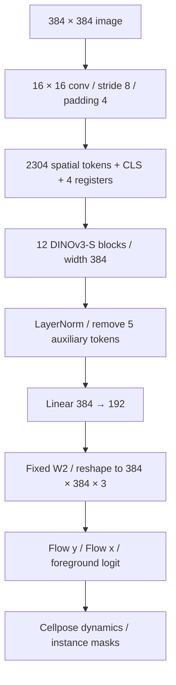

# CPDINO model and training specification

## Output-level knowledge distillation

Student output `p` and teacher output `t` have shape `[N, 3, H, W]`. Channels 0–1 are flow and channel 2 is the foreground logit. Labels `y` have `[foreground, flow_y, flow_x]` after removing the instance-ID plane.

```text
L_task = 0.5 × MSE(p_flow, 5 × y_flow) + BCEWithLogits(p_cell, y_foreground > 0.5)
L_KD   = MSE(p_flow, stopgrad(t_flow)) + MSE(p_cell, stopgrad(t_cell))
L      = L_task + lambda × L_KD
```

The historical ViT-B run uses lambda 1, a directly fine-tuned ViT-B student and a frozen CPDINO ViT-L teacher. Validation uses only L_task so comparisons are independent of the teacher target. This is dense output regression distillation. The recipe matches flow values and raw foreground logits.

## ViT-S backbone substitution

The ViT-S encoder comes from `facebook/dinov3-vits16-pretrain-lvd1689m`. It has 12 blocks, embedding width 384, 6 attention heads and MLP ratio 4. CPDINO adds a linear head producing 192 values per spatial token.



The original adapter temporarily replaced the upstream ViT-B factory to create the S variant. `AdaptedCPDINO` now takes the encoder explicitly and inherits the upstream forward path. Four register tokens and patch-16 input are checked at the boundary. Factory construction uses `pretrained=False`; checkpoint loading is a separate unit with a hash check.

The Transformers checkpoint conversion joins Q/K/V, inserts the zero K bias, maps layer scale and MLP names, and checks every tensor shape. Extra and missing tensors fail. The source-format conversion is currently verified for the official ViT-S checkpoint used in this project. Raw DINOv3 encoder state dicts can also be loaded.

## Optimization parameters

Upstream CPDINO applies the patch projection using `.data`; this blocks gradients into its weights. The adapter marks these parameters frozen explicitly. Transformer blocks and the linear readout are optimized. W2 and diameter parameters are fixed. The inherited mask token is unused by this segmentation forward path.

The completed supervised S experiment uses lambda 0, AdamW, LR 1e-5, weight decay 0.1, 500 epochs, batch 29, 384-pixel tiles and validation every 10 epochs. B distillation uses batch 13. Exact dataset iteration is in the notebook, and checkpoint metadata includes the recipe and dataset file manifest fingerprint.

## Reproduction limits

The CPU unit notebook verifies execution with synthetic inputs. Public results were imported from the prior full experiment. Private images and checkpoint access are required to repeat those scores. The new modular implementation preserves the model forward and loss path, with explicit data/weight validation. It has been checked against the official ViT-S weights and a historical S state dict, but its entire 500-epoch trajectory has not been repeated.

Notebook resumptions are supported at epoch boundaries. NumPy, Python and Torch RNG, model and optimizer are restored. The experiment configuration and dataset fingerprint must match. Cross-device/library-version runs can have different numerical trajectories.

Direct B starts from a Cellpose segmentation checkpoint. S starts from a general DINOv3 encoder with a newly initialized segmentation head. An architecture-only accuracy comparison would require controlling this initialization difference as well as data, training budget and evaluation settings.

Historical test scores refer to the original campaign artifacts. Additional ViT-S distillation uses the public training units described below.

## ViT-S output distillation

The additional S experiment initializes the complete student model from the selected 500-epoch supervised S checkpoint. It uses the same frozen CPDINO ViT-L teacher and output loss as B distillation, with teacher weight 1, batch size 13 and 500 additional epochs. Encoder-only initialization remains a separate supervised recipe. `prepare_models` resolves the configured initialization key and scope explicitly.

`train_epoch` executes one epoch over the selected `train_eligible` split, validates using the supervised loss and records progress. `EpochStore` stores both the minimum-validation-loss checkpoint and the latest optimizer/RNG state, including best loss and best epoch for resumption. The notebook uses a separate run directory from an unattended run.

The supervised S test evaluation is complete. Additional S distillation metrics remain pending until its selected checkpoint is evaluated under the same 64-image BF16 protocol. `evaluation.py` provides instance matching metrics, per-image median latency aggregation and an aggregate export that excludes sample identifiers.
